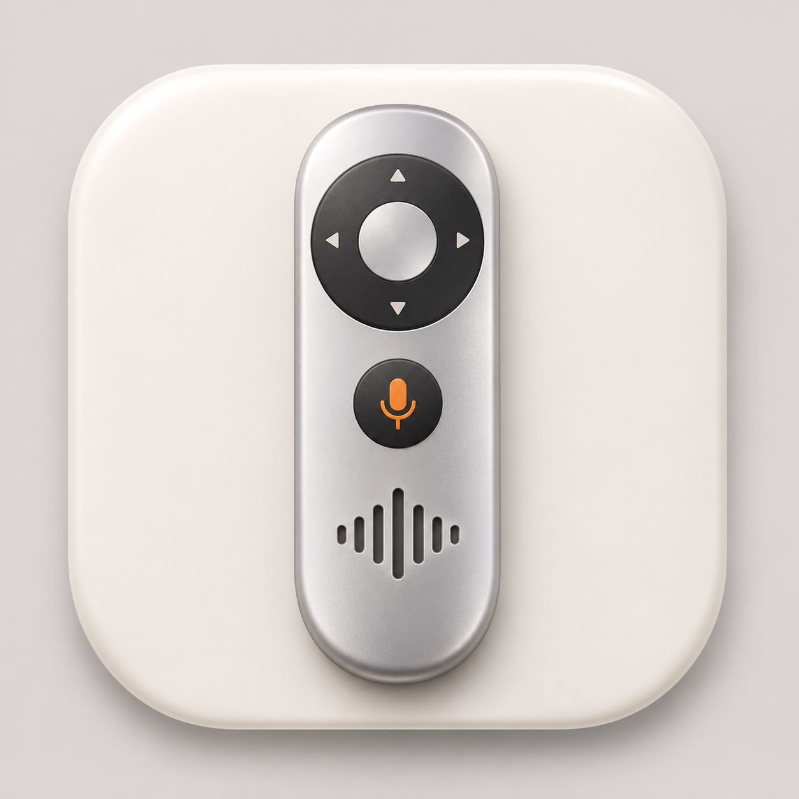
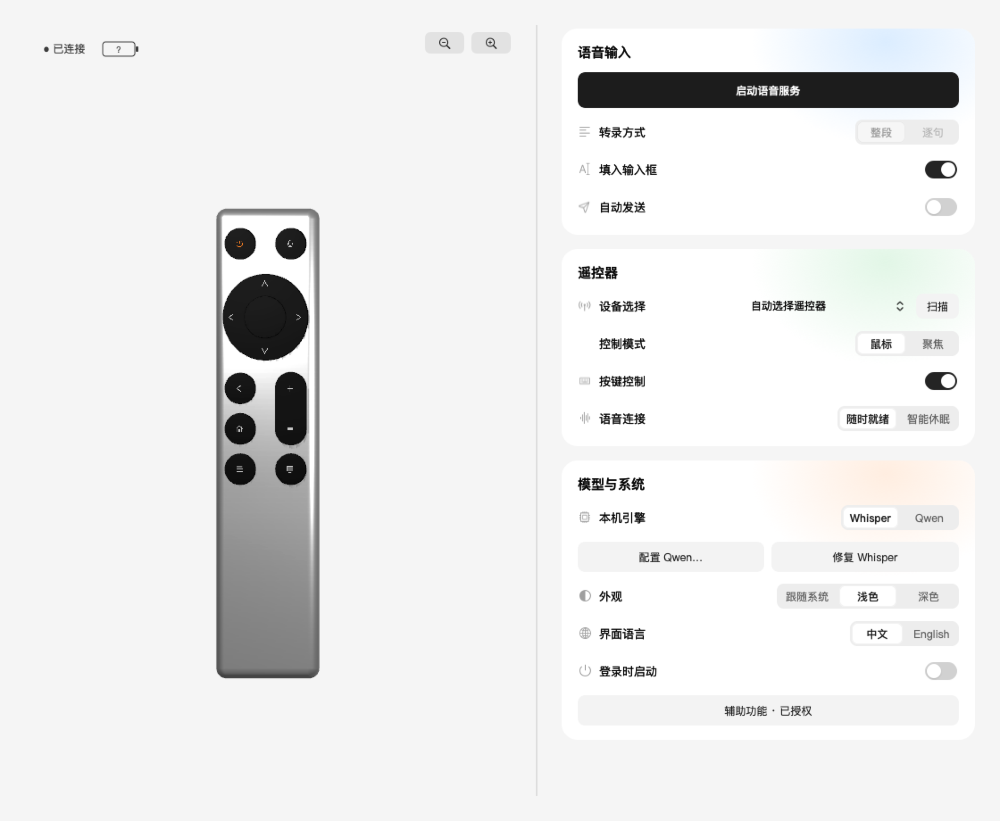
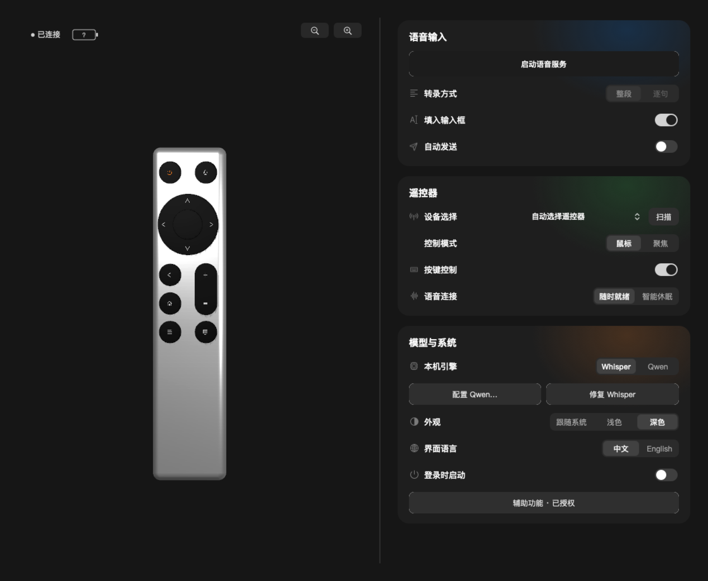
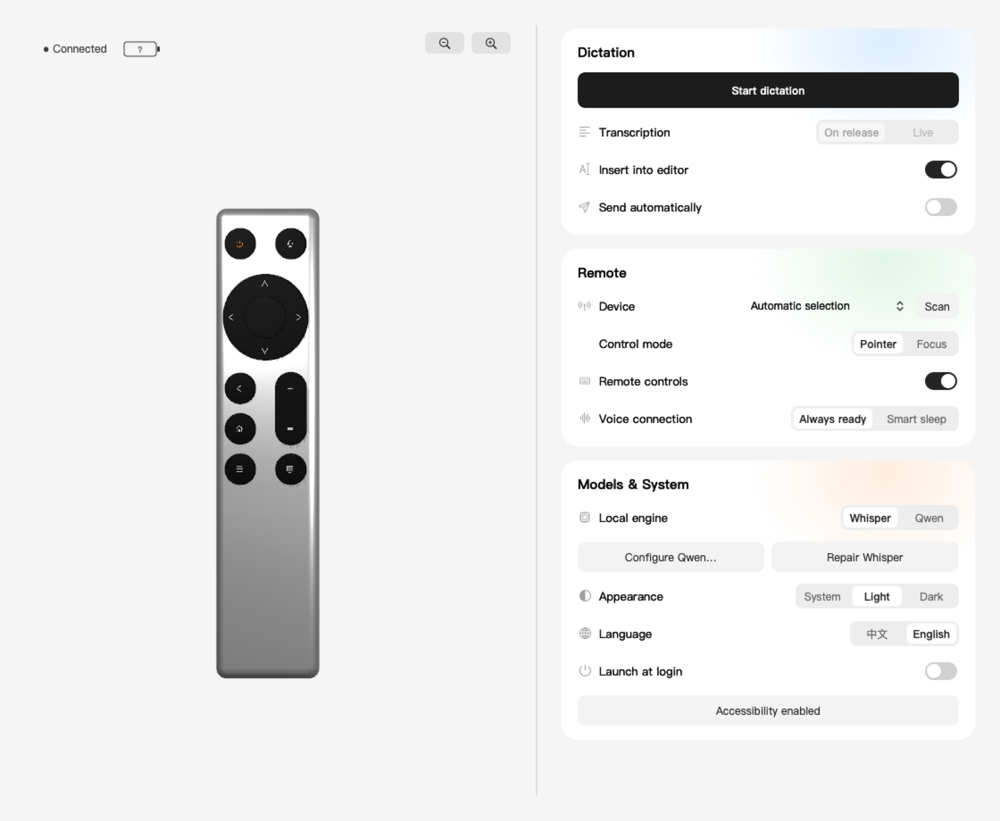
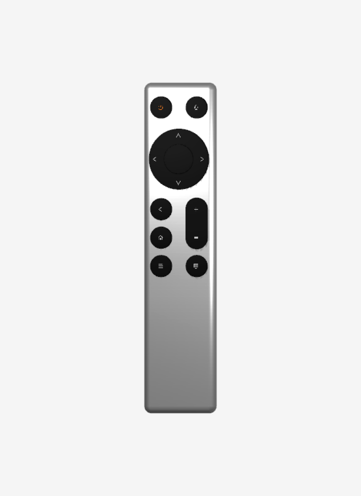
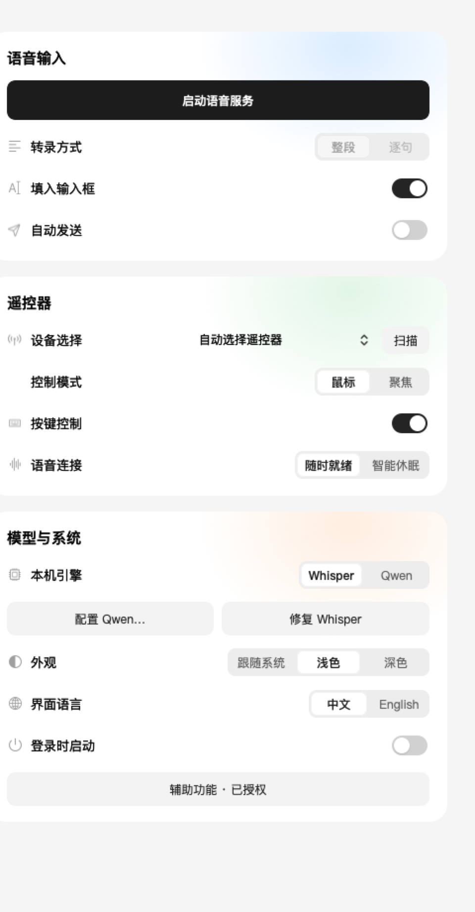

[產品官網 / Product website](https://novatechai.xyz/remotevoice/) · [繁體中文](https://novatechai.xyz/zh-hant/remotevoice/)

<div align="center">



# 小米遥控器 Vibe Coding Codex for macOS

**让兼容蓝牙遥控器成为 Mac 的语音输入与控制工具。**

[](https://github.com/win060787-del/xiaomi-remote-vibe-coding-codex-macos)
[](Package.swift)
[](LICENSE)

**中文** · [English](README_EN.md)

[界面预览](#-界面预览) · [安装](#-安装) · [模型配置](#-模型配置) · [按键映射](#-按键映射) · [与上游的关系](#-与上游的关系)

</div>

遥声是一款原生 macOS 应用，把兼容 ATVV 协议的蓝牙语音遥控器接入 Mac：按住语音键录音，在 Mac 本地使用 Whisper 或 Qwen 转写；通过方向、确认、返回等按键控制指针和键盘，并提供 Codex 输入集成。

当前开发版本 **0.2.2**。基于 [fanxeon/mi-ao](https://github.com/fanxeon/mi-ao) 持续开发，保留 MIT 许可证与原作者署名。适合愿意参与硬件兼容性和本地识别测试的用户，目前以源码构建为主。

## 一次典型使用

打开 Mac 上的 Codex，进入要继续的任务，点击输入框。按住遥控器语音键，说“帮我检查当前分支的改动，找出可能影响登录的地方”，然后松开。开启“填入输入框”后，转写会进入 Codex 编辑区。保留默认的手动发送设置，可以先修正文件名、命令或产品术语，再点击发送。

| 想做什么 | 怎么用 |
| --- | --- |
| 一边说话一边补充长指令 | 配置 Qwen 后选择“逐句”，说话期间分段更新，松开后校正整段文字 |
| 只记录语音和文字 | 关闭“填入输入框”，从菜单栏的“录音与文字记录”查看本地文件 |
| 看结果、翻页、切任务 | HOME 单击向下翻页，双击向上翻页。音量键切换 Codex 侧边栏项目 |
| 在指针和方向键之间切换 | 按 TV 键。鼠标模式用方向键移动指针，聚焦模式用方向键和回车操作当前界面 |

## 🖼️ 界面预览

以下图片由当前 AppKit / SceneKit 界面代码在隔离配置下原生渲染，不是设计稿。它们展示界面与模型，不代表所有设备、权限或语音链路均已验收；不包含用户录音、设备 UUID 或本机模型路径。



| 深色模式 | English |
| --- | --- |
|  |  |

<details>
<summary>查看遥控器模型与控制选项细节</summary>

| 可旋转的银色遥控器 | 语音、遥控器、模型与系统配置 |
| --- | --- |
|  |  |

截图说明与生成方式见 [截图索引](docs/screenshots/README.md)。

</details>

## ✨ 功能

- **本地语音转写**：遥控器采集语音，Mac 执行 Whisper 或 Qwen 识别；识别流程不调用云端转写 API。
- **两种输入节奏**：整段在松开按键后转写；Qwen 逐句模式在说话过程中分段更新，最终结果在松开后校正。
- **手动决定发送**：默认关闭自动发送；可选择填入 Codex 输入框，或仅保留本地转写文件。
- **两种控制模式**：鼠标模式移动指针与点击；聚焦模式发送方向键与 Return，TV 键切换并保存模式。
- **点击模型编辑映射**：拖动 3D 遥控器旋转、缩放，点击可编辑按键设置动作；语音键与菜单键保留系统用途。
- **设备与电量**：扫描附近 BLE 设备，标记兼容性、选择遥控器；兼容设备可独立读取电量，无需先启动识别模型。
- **原生桌面界面**：银色 SceneKit 遥控器、苹方字体、浅色／深色／跟随系统、中文／English。
- **本机配置与运行管理**：连接与权限检查、登录启动选项、模型配置、构建失败回滚，成功构建后仅保留最新应用。

## 📦 安装

### 💻 环境要求

| 项目 | 要求 |
| --- | --- |
| 系统 | macOS 14+ |
| 构建 | Swift 6+，Xcode 或 Command Line Tools |
| 硬件 | 已适配的 ATVV 蓝牙语音遥控器；当前主要验证小米蓝牙语音遥控器 2 Pro |
| Whisper | Homebrew 或已安装且可执行的 `whisper-cli` |
| Qwen | Apple Silicon、兼容的 Python / MLX 环境及完整本地模型 |
| Codex 集成 | 安装并运行 Codex，按实际功能授权辅助功能 |

Apple Silicon 构建已验证。Intel 的 Whisper 路径仍保留，但尚未完成 Intel 实机验收；Qwen 的 MLX 路径仅适用于 Apple Silicon。蓝牙可配对不代表设备一定支持语音协议。

```sh
git clone https://github.com/win060787-del/xiaomi-remote-vibe-coding-codex-macos.git
cd xiaomi-remote-vibe-coding-codex-macos
./scripts/setup.sh
```

安装程序检查环境、准备 Whisper small 多语言模型（约 488 MB）、验证 SHA-256，构建并安装 `~/Applications/遥声.app`。源码目录可移动，不要求固定磁盘或目录。

> [!NOTE]
> 当前本地构建采用临时签名，尚未提供 Developer ID 签名、公证的正式安装包，也不是已审核的 Mac App Store 版本。首次设置会访问模型下载源；本地识别时不下载模型。需要自行准备兼容遥控器。

### 🔗 首次连接

1. 在 macOS 蓝牙设置中完成遥控器配对。
2. 打开遥声，在右侧“设备选择”中点击“扫描”，从列表选择兼容设备；配对操作仍在系统设置中完成。
3. 点击左上角连接状态，检查蓝牙、本地模型与相应控制权限。
4. 需要指针、键盘或 Codex 输入功能时，为当前安装的遥声授予辅助功能权限。
5. 配置识别引擎后点击“启动语音服务”；保持“自动发送”关闭，先做一轮按住说话、松开转写测试。

左上角“已连接”表示设备蓝牙连接状态，不等同于语音桥接已就绪。问号电池表示尚未取得有效电量，不伪造电量。部分偏好需重启语音服务才生效，具体条件可悬停查看。

### 首次使用怎么验收

按下面的顺序测试，可以把配对、转写和输入分开排查。

1. **识别设备**。扫描后选择已配对的遥控器。设备有电量读数时，可先用它确认电量服务已响应。
2. **本地转写**。关掉“填入输入框”和“自动发送”，启动语音服务，按住语音键说一句完整的话。松开后从菜单栏打开“录音与文字记录”，检查新增的 WAV 和同名 TXT。
3. **输入 Codex**。打开 Codex 并选中目标输入框，开启“填入输入框”，再录一句。检查文字是否填入、是否仍可编辑，以及是否需要你手动发送。
4. **验证按键**。打开“按键控制”并按提示重启服务。先测试方向、确认和返回键，再用 TV 键切换模式复测，最后验证音量键是否切到预期的 Codex 任务。

更换设备、本机引擎或按键控制状态后，停止再启动语音服务以应用设置。平时需要断连后自动恢复，可选“随时就绪”。希望连续重连失败后暂停尝试，可选“智能休眠”，再通过遥控器按键唤醒。

## 🧠 模型配置

| 引擎 | 运行位置 | 输入方式 | 配置要求 |
| --- | --- | --- | --- |
| Whisper small | Mac 本地 | 整段 | `whisper-cli` 与多语言权重 |
| Qwen3-ASR-1.7B / MLX | Apple Silicon Mac 本地 | 整段、逐句更新 | Python 环境、`mlx-audio` 与兼容的 MLX 权重 |

模型运行在 **Mac，不在遥控器上**。遥控器负责采集和传输音频。

### ⚙️ Qwen

在自己的 Python 3.12 虚拟环境中安装锁定依赖，并按模型提供方说明取得完整 MLX 模型。模型权重不随本仓库分发，使用前应核对其许可证与运行需求。

```sh
python3.12 -m venv .venv-qwen
.venv-qwen/bin/python -m pip install -r qwen-requirements.lock.txt
```

在右侧“模型与系统”点击“配置 Qwen…”，依次选择包含 `config.json`、`model.safetensors` 的模型文件夹和虚拟环境中的 `bin/python`。配置时记录模型 SHA-256，启动时再次校验；环境或模型被移动后需重新选择。

命令行替代方式：

```sh
./scripts/configure-qwen.sh /path/to/venv/bin/python /path/to/model
```

逐句输入采用**累积音频分段重识别**，不是模型原生流式解码。识别速度、准确率和首次加载时间取决于 Mac、模型、蓝牙音质及说话方式；当前不承诺无漏字或任意应用通用输入。

## 🎛️ 按键映射

以下为默认行为，自定义配置可覆盖可编辑按键。

| 按键 | 鼠标模式 | 聚焦模式 |
| --- | --- | --- |
| 方向 | 平滑移动指针 | 键盘方向键 |
| 中间确认 | 鼠标左键 | Return |
| 返回 | 短按删除一个字符；长按删除当前段落 | Escape |
| HOME | 单击 Page Down；双击 Page Up | 同左 |
| 菜单 | 系统原生鼠标右键 | 同左 |
| 音量 ± | Codex 上一个／下一个侧边栏项目 | 同左 |
| 电源 | 启动或聚焦 Codex | 同左 |
| TV | 切换并保存控制模式 | 切换并保存控制模式 |
| 语音 | 按住说话，松开结束 | 同左 |

悬停模型按键查看当前动作；点击可编辑按键打开映射编辑。内置预设被编辑时另存为用户预设，语音键和菜单键保留固定用途。拖动用于旋转，不触发按键编辑。顶部 −／＋与滚轮均可缩放。

Codex 专属动作需要该应用；普通指针与键盘动作不依赖 Codex 的聊天内容。配置热更新和重启保留已保存的控制模式，映射仅针对兼容硬件，不覆盖其他键盘映射。

## 🔐 数据与权限

| 内容 | 默认位置或用途 |
| --- | --- |
| 偏好、设备选择、日志、录音与转写 | `~/Library/Application Support/RemoteVoice/` |
| Whisper 权重 | `~/.cache/RemoteVoice/` |
| 蓝牙权限 | 连接设备、接收语音、读取电量 |
| 辅助功能 | 执行指针／键盘动作及核验 Codex 输入区 |
| 登录启动 | 用户主动开启，由 macOS 登录项管理 |

可通过 `VOICE_BRIDGE_DATA_DIR` 与 `VOICE_BRIDGE_MODEL_DIR` 覆盖数据和模型目录。外部模型路径只存于本机配置，不写回源码。不会自动迁移或删除米遥及其他应用的数据；发布源码不包含开发者配对信息、录音、模型或 Python 环境。

录音和转写可能包含敏感内容，即使只保存在本机也应自行管理保留周期。提交问题前请删除原始语音、设备标识、用户名和实际路径。更多说明见 [安全策略](SECURITY.md)。

## 常见问题

| 现象 | 从哪里查起 |
| --- | --- |
| 已配对，扫描列表里找不到遥控器 | 唤醒遥控器，检查 macOS 蓝牙状态和遥声的蓝牙权限，再扫描一次。音频功能需要适配的 ATVV 语音协议 |
| 左上角显示已连接，按语音键没有生成 WAV | 查看语音服务是否已启动，确认当前选中设备，切换设备后重启服务。蓝牙连接、电量读取和语音链路各有独立状态 |
| 有 WAV，没有同名 TXT | 在“设置与诊断”检查所选引擎。Whisper 核对可执行文件和模型，Qwen 核对 Python 环境与 MLX 模型目录。先录一句完整的话，排除录音过短 |
| 有 TXT，Codex 输入框里没有文字 | 确认开启了“填入输入框”，Codex 正在运行，目标输入区可用，并检查当前遥声应用的辅助功能权限 |
| 方向键行为和预期不同 | 检查当前是鼠标模式还是聚焦模式，并确认“按键控制”已开启。可用 TV 切换，再确认映射是否来自自定义预设 |
| 重建或移动应用后按键失效 | 打开当前使用的那份遥声，在“设置与诊断”重新检查辅助功能。如果系统里的授权对应旧构建，重新授权当前应用 |
| 需要停止控制或恢复遥控器 | 从菜单栏选择“安全退出并恢复遥控器” |

## 🛠️ 开发与验证

```sh
make check
make app
```

`make check` 覆盖 Swift 格式、业务测试、脚本环境隔离、安装与失败回滚、应用搬移及构建保留策略。`make app` 在 `dist/` 生成最新应用；成功构建并验证后移除旧构建，失败时保留上一次可用应用。它不会删除源码、模型、用户数据或编译缓存。

<details>
<summary>源码结构与常用维护命令</summary>

```text
Sources/MiAo/       原生界面、BLE 语音、HID 控制、本地 ASR 与输入处理
Tests/             Swift 业务测试与安装、打包等脚本测试
Resources/         应用元数据、硬件配置、品牌资源与模型校验信息
scripts/           安装、构建、运行、模型配置及源码导出
.github/           CI、问题模板与依赖维护
docs/             当前指南、截图与上游历史资料
```

- `make build` / `make release`：调试／发布构建。
- `make test` / `make lint`：Swift 测试／格式检查。
- `make preflight` / `make verify`：安装环境／已安装应用检查。
- `./scripts/start.sh` / `./scripts/stop.sh`：启动／安全停止运行服务。
- `./scripts/export-snapshot.py`：生成不含 Git 历史、缓存、模型和用户数据的开发源码快照。
- `make source-release`：从干净、已提交的工作区生成正式源码包。

内部 Swift target 与部分历史脚本仍沿用 MiAo 命名，以保留上游代码结构；产品名为遥声 RemoteVoice。

</details>

## 🧭 当前边界

- 仅支持 macOS 和已适配遥控器，不支持 Windows 或任意蓝牙遥控器。
- 界面语言为中文与 English，部分底层诊断信息仍保留中文。
- 不包含云端转写、多 Mac 同步、应用自动切换预设或个人词库；这些不是当前已交付功能。
- 自动检查不等于全设备验收。其他 Mac、遥控器固件、休眠重连、权限恢复和完整语音输入仍需持续验证。
- 此仓库是直接分发开发版本。Mac App Store 版本需要另外验证沙盒、运行环境与跨应用控制能力，不保证原样上架。

## 🌱 与上游的关系

遥声基于 [MI-AO / 米遥](https://github.com/fanxeon/mi-ao) 开发。上游已经提供 BLE 语音桥接、HID 按键、原生设置、映射预设等基础；这些不作为遥声原创能力宣传。

本分支重点调整了：

| 方向 | 本分支工作 |
| --- | --- |
| 原生界面 | 左右布局、可交互银色 3D 遥控器、主题与语言选择、设备扫描与权限弹窗 |
| 本地识别 | Qwen 运行环境配置、完整性校验、分段识别与最终校正 |
| 文本与控制 | 手动发送默认、流式输入选区处理、短按／长按删除、指针移动与模式持久化 |
| 可迁移性 | 当前用户数据目录、外部模型显式选择、移除开发者固定路径与设备标识 |
| 运行交付 | 电量独立读取、状态区分、安装回滚、构建保留策略与相应测试 |

保留原作者 **FanXeon@Poemcoder with Codex** 的版权与许可。历史资料在 `docs/upstream/`，其中旧品牌、旧截图和旧功能描述仅供溯源，当前功能以本 README 与源码为准。项目并非 Xiaomi、OpenAI、Google 或上游作者的官方产品，也不暗示其背书。

## 🤝 参与与支持

欢迎提交硬件兼容性、连接重试、识别质量和无障碍反馈。请附 macOS 版本、芯片、遥控器型号／固件、引擎和脱敏复现步骤。先阅读 [贡献指南](CONTRIBUTING.md)，再通过 [Issues](https://github.com/win060787-del/xiaomi-remote-vibe-coding-codex-macos/issues) 提交。

## 📜 许可证

沿用 [MIT License](LICENSE)，保留原版权与许可声明。来源和第三方组件见 [NOTICE](NOTICE) 与 [THIRD_PARTY_NOTICES.md](THIRD_PARTY_NOTICES.md)。模型权重与外部依赖各自遵守其许可证，MIT 不替代它们的许可要求。
