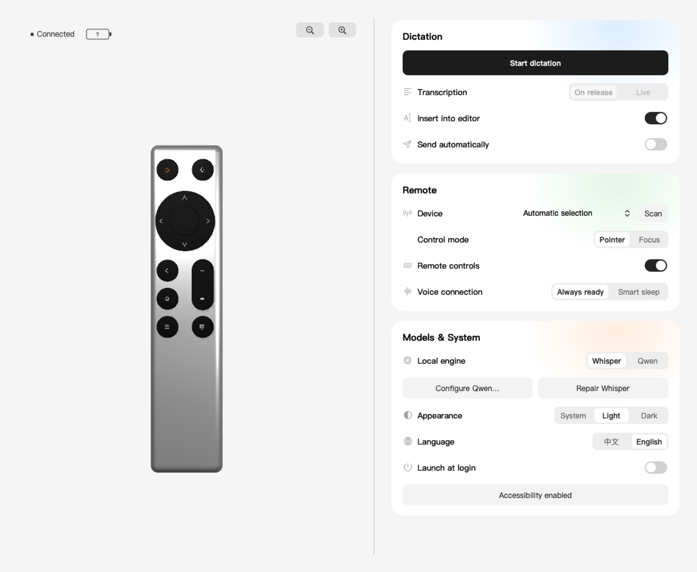
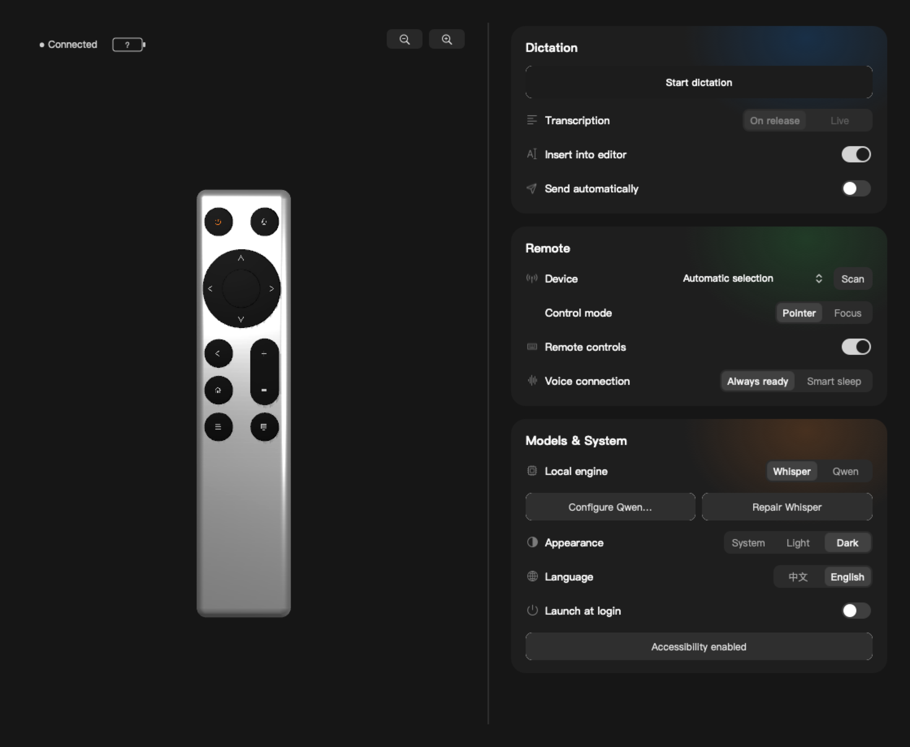
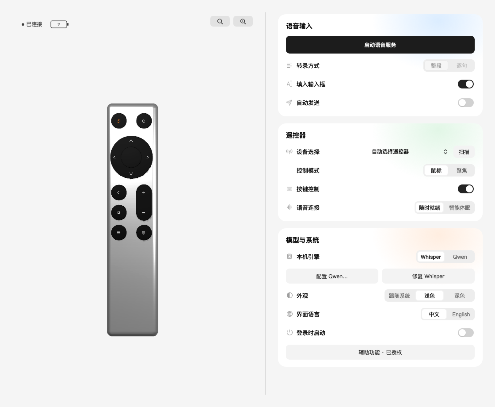
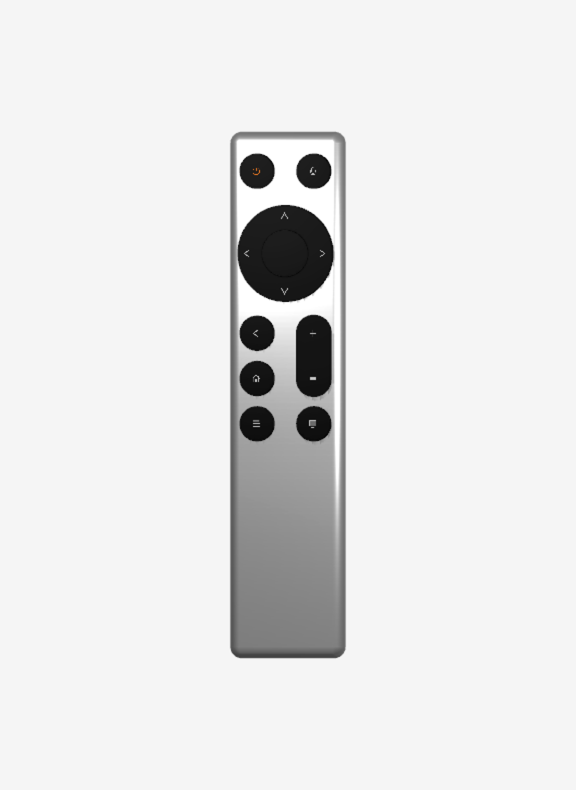
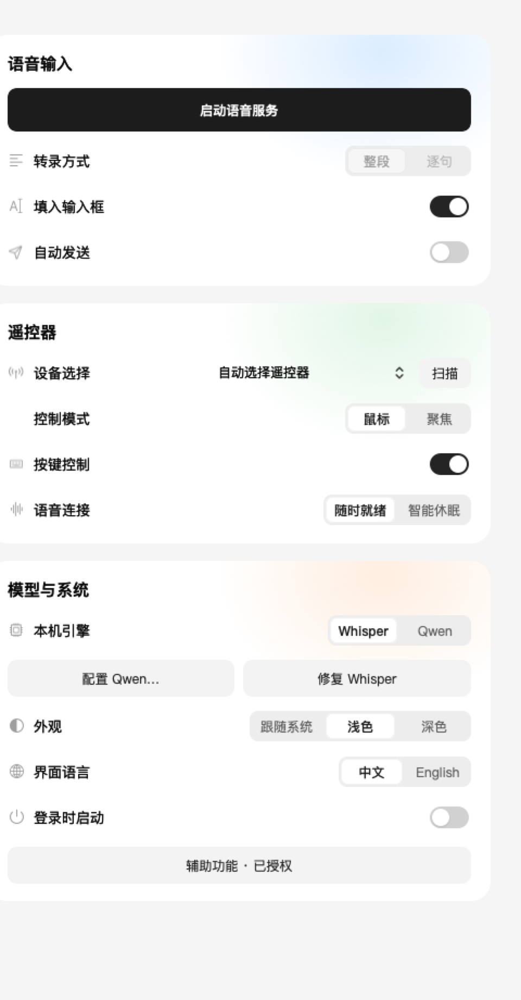

<div align="center">

# Xiaomi Remote · Vibe Coding · Codex for macOS

**A native Mac companion for Bluetooth remote dictation and control.**

[](https://github.com/win060787-del/xiaomi-remote-vibe-coding-codex-macos)
[](Package.swift)
[](LICENSE)

[中文](README.md) · **English**

[Preview](#-preview) · [Installation](#-installation) · [Models](#-models) · [Button mappings](#-button-mappings) · [Upstream](#-upstream-and-attribution)

</div>

RemoteVoice connects a supported ATVV Bluetooth voice remote to macOS. Hold the voice button to record, transcribe locally on your Mac with Whisper or Qwen, and use the remote to move the pointer, click, send keyboard actions, and interact with Codex.

Development version **0.2.2**, derived from [fanxeon/mi-ao](https://github.com/fanxeon/mi-ao), with the original MIT license and attribution retained. This source-first development build is intended for users willing to help test hardware compatibility and local recognition.

## 🖼️ Preview

These images are native renders of the current AppKit / SceneKit interface using an isolated configuration, not design mockups. They demonstrate the UI rather than successful hardware or speech acceptance. They contain no user recordings, device UUIDs, or personal model paths.



| Dark appearance | Chinese interface |
| --- | --- |
|  |  |

<details>
<summary>Remote model and control details</summary>

| Silver remote with black buttons | Settings cards |
| --- | --- |
|  |  |

See [screenshot notes](docs/screenshots/README.md) for capture provenance.

</details>

## ✨ Features

- **Local transcription:** receive remote audio over BLE and run Whisper or Qwen on the Mac, without a cloud transcription API.
- **Two transcription modes:** transcribe the complete recording on release, or update partial results while speaking with Qwen and finalize on release.
- **Manual sending by default:** insert text into the Codex editor, or retain local transcripts without insertion; automatic sending is an explicit option.
- **Pointer and focus modes:** move and click the pointer, or send arrow keys and Return. The TV button switches and saves the mode.
- **Direct mapping from the model:** rotate and zoom the 3D remote, hover to inspect actions, and click an editable button to change its mapping.
- **Device selection and battery:** scan nearby advertising BLE devices, distinguish compatible remotes, and read supported battery levels independently of the ASR service.
- **Native desktop interface:** PingFang typography, light / dark / system appearance, Chinese / English interface language.
- **Local runtime management:** connection and permission checks, optional launch at login, explicit model selection, atomic installation rollback, and retention of the latest successful app build.

## 📦 Installation

### 💻 Requirements

| Component | Requirement |
| --- | --- |
| OS | macOS 14+ |
| Build tools | Swift 6+, Xcode or Command Line Tools |
| Hardware | An adapted ATVV voice remote; current testing primarily uses Xiaomi Bluetooth Voice Remote 2 Pro |
| Whisper | Homebrew or an executable `whisper-cli` |
| Qwen | Apple Silicon, a compatible Python / MLX environment, and complete local model weights |
| Codex integration | Codex installed and running, with Accessibility permission for the selected features |

Apple Silicon builds have been verified. The Intel Whisper path remains available but has not been accepted on an Intel Mac; the Qwen MLX path requires Apple Silicon. Pairing successfully does not prove that a remote supports the required voice protocol.

```sh
git clone https://github.com/win060787-del/xiaomi-remote-vibe-coding-codex-macos.git
cd xiaomi-remote-vibe-coding-codex-macos
./scripts/setup.sh
```

Setup checks the environment, prepares the Whisper small multilingual model (about 488 MB), verifies SHA-256, builds the app, and installs it at `~/Applications/遥声.app`. There is no required source checkout or external disk location.

> [!NOTE]
> Local builds are ad-hoc signed. A Developer ID signed and notarized distribution is not yet provided, and this is not an approved Mac App Store build. Initial setup accesses model download sources; inference does not download weights. A compatible physical remote is required.

### 🔗 First connection

1. Pair the remote in macOS Bluetooth settings.
2. Open RemoteVoice, select **Scan** in the device row, and choose a compatible remote. Pairing itself remains in System Settings.
3. Click the connection indicator to inspect Bluetooth, model, and control permissions.
4. Allow Accessibility for this installed RemoteVoice app when using pointer, keyboard, or Codex editor actions.
5. Configure a local engine and choose **Start dictation**. Keep automatic sending off for the first hold-to-talk test.

The connection indicator describes the Bluetooth link, not voice bridge readiness. A question mark inside the battery means no valid reading is available. Some preferences require restarting dictation; hover over the relevant option for its conditions.

## 🧠 Models

| Engine | Runs on | Transcription | Required files |
| --- | --- | --- | --- |
| Whisper small | Mac | On release | `whisper-cli` and multilingual weights |
| Qwen3-ASR-1.7B / MLX | Apple Silicon Mac | On release or partial updates | Python, `mlx-audio`, compatible MLX weights |

The model runs on the **Mac, not the remote**. The remote captures and transports audio.

### ⚙️ Qwen configuration

Create a Python 3.12 environment, install the locked dependencies, and obtain a complete compatible MLX model following its provider's instructions. Weights are not redistributed here; review their license and runtime requirements separately.

```sh
python3.12 -m venv .venv-qwen
.venv-qwen/bin/python -m pip install -r qwen-requirements.lock.txt
```

Choose **Configure Qwen…** in **Models & System**. Select the folder containing `config.json` and `model.safetensors`, followed by the environment's `bin/python`. Configuration records the model SHA-256, which is checked again at startup. Reconfigure after moving the model or environment.

Command-line alternative:

```sh
./scripts/configure-qwen.sh /path/to/venv/bin/python /path/to/model
```

Live updates use **re-recognition of accumulated audio segments**, not native streaming decoding. The final result is corrected on release. Speed, accuracy, and initial load time depend on hardware, weights, Bluetooth audio, and speech. Lossless recognition and universal editor support are not promised.

## 🎛️ Button mappings

Defaults below can be overridden for editable buttons.

| Button | Pointer mode | Focus mode |
| --- | --- | --- |
| D-pad | Smooth pointer movement | Arrow keys |
| Center | Primary mouse click | Return |
| Back | Tap: delete one character; hold: delete current paragraph | Escape |
| Home | Tap: Page Down; double tap: Page Up | Same |
| Menu | Native secondary click | Same |
| Volume + / − | Previous / next Codex sidebar item | Same |
| Power | Launch or focus Codex | Same |
| TV | Switch and persist control mode | Same |
| Voice | Hold to talk, release to finish | Same |

Hover over a model button to inspect its current action. Click an editable button to open its mapping editor; changing a built-in preset creates a user preset. Voice and Menu retain their reserved roles. Dragging rotates the model without opening the editor. Top − / + buttons and the scroll wheel adjust zoom.

Codex-specific actions require Codex. Ordinary pointer and keyboard actions do not depend on chat contents. Saved control mode survives configuration refresh and restart. Device mapping is scoped to supported hardware rather than other keyboards.

## 🔐 Data and permissions

| Item | Location or purpose |
| --- | --- |
| Preferences, selected device, logs, recordings, transcripts | `~/Library/Application Support/RemoteVoice/` |
| Whisper weights | `~/.cache/RemoteVoice/` |
| Bluetooth | Remote connection, voice transport, battery reading |
| Accessibility | Pointer / keyboard actions and Codex editor verification |
| Launch at login | Explicit user option managed by macOS |

`VOICE_BRIDGE_DATA_DIR` and `VOICE_BRIDGE_MODEL_DIR` override storage locations. External model paths remain in local configuration rather than source. RemoteVoice does not automatically migrate or delete MI-AO or other apps' data. Developer device identifiers, recordings, models, and Python environments are excluded from source distribution.

Local recordings and transcripts can still be sensitive. Manage their retention and redact audio, identifiers, usernames, and real paths before reporting issues. See [security policy](SECURITY_EN.md).

## 🛠️ Development and checks

```sh
make check
make app
```

Checks cover Swift formatting and business behavior, shell environment isolation, installation and rollback, app relocation, and build retention. `make app` produces the latest app under `dist/`; old builds are removed only after a successful verified build. Failed builds retain the last usable app. Source, models, user data, and compilation caches are not removed by this retention policy.

<details>
<summary>Source structure and maintenance commands</summary>

```text
Sources/MiAo/   Native UI, BLE voice, HID controls, local ASR, text input
Tests/         Swift behavior tests and shell delivery checks
Resources/     App metadata, hardware profiles, brand assets, model checksum
scripts/       Setup, packaging, runtime, model configuration, source export
.github/       CI and issue templates
docs/          Current guides, screenshots, historical upstream material
```

- `make build` / `make release`: debug / release compilation.
- `make test` / `make lint`: Swift tests / formatting checks.
- `make preflight` / `make verify`: prerequisites / installed app checks.
- `./scripts/start.sh` / `./scripts/stop.sh`: start / safely stop runtime.
- `./scripts/export-snapshot.py`: export a development snapshot without Git history, caches, models, or user data.
- `make source-release`: package a clean committed checkout.

Internal Swift targets and some historical scripts retain MiAo naming to preserve the upstream structure. The product is RemoteVoice / 遥声.

</details>

## 🧭 Current boundaries

- macOS and adapted remotes only; no Windows or arbitrary Bluetooth remote support.
- Chinese and English UI; some lower-level diagnostic output remains Chinese.
- No cloud transcription, multi-Mac sync, automatic per-app profile switching, or personal vocabulary feature is delivered here.
- Automated checks are not a substitute for hardware acceptance. More Mac models, remote firmware, sleep / reconnect, permission recovery, and complete voice input need continuing tests.
- This is a direct-distribution development build. A Mac App Store edition requires separate sandbox, runtime, and cross-app control validation.

## 🌱 Upstream and attribution

RemoteVoice derives from [MI-AO](https://github.com/fanxeon/mi-ao). Upstream already provides BLE voice bridging, HID control, native settings, and mapping presets; these are not claimed as original RemoteVoice inventions.

| Area | Work in this derivative |
| --- | --- |
| Native interface | Split layout, interactive silver 3D remote, themes, language selection, device scan and permission sheets |
| Local recognition | Qwen runtime configuration, model integrity checks, partial transcription and final correction |
| Text and controls | Manual-send default, partial input selection handling, tap / hold deletion, pointer tuning, persistent mode |
| Portability | Per-user storage, explicit external model selection, removal of developer paths and device identifiers |
| Runtime delivery | Independent battery reading, distinct connection states, installation rollback, build retention, related tests |

The original **FanXeon@Poemcoder with Codex** copyright and license are retained. `docs/upstream/` contains historical references whose old branding, screenshots, and behavior do not describe this version. This is not an official Xiaomi, OpenAI, Google, or upstream-author product and implies no endorsement.

## 🤝 Contributing and support

Hardware compatibility, reconnection, recognition quality, and accessibility reports are welcome. Include macOS, chip, remote model / firmware, engine, and redacted reproduction steps. Read [contributing](CONTRIBUTING.md) and use [Issues](https://github.com/win060787-del/xiaomi-remote-vibe-coding-codex-macos/issues).

## 📜 License

[MIT License](LICENSE), retaining original copyright and permission notices. See [NOTICE](NOTICE) and [THIRD_PARTY_NOTICES.md](THIRD_PARTY_NOTICES.md). Model weights and external dependencies remain subject to their own licenses.
